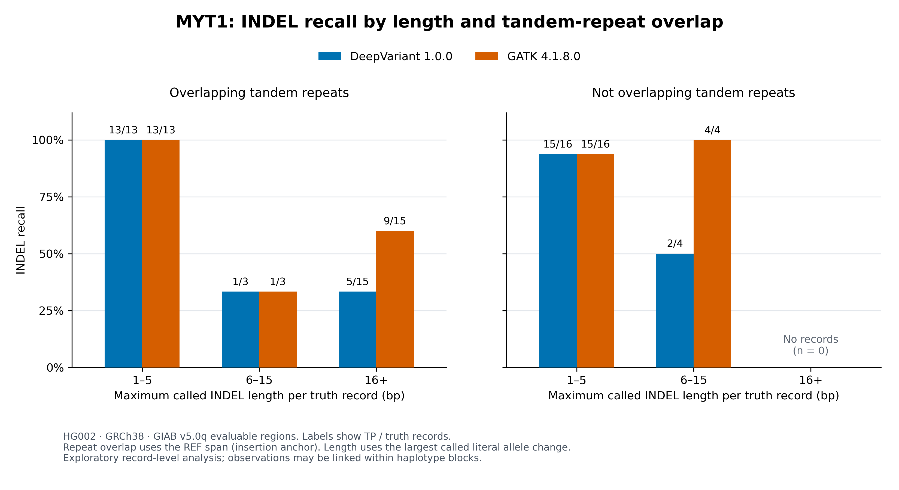

# HG002 Small-Variant Benchmarking in Challenging Gene Regions

**A reproducible, gene-focused evaluation of published DeepVariant and
GATK call sets, with record-level error analysis.**

[Türkçe açıklama](README.tr.md)

## Research question

Where do two HG002 small-variant call sets differ in detection accuracy,
and how do observed errors relate to gene region, INDEL length and
tandem-repeat overlap?

The project evaluates existing calls. It does not rerun variant calling
from FASTQ/BAM or constitute clinical validation.

## Main results

Results below concern the selected evaluable regions and supplied
historical call sets. They are not genome-wide estimates.

| Type | Call set | Truth records | FN | Query FP | Recall | Precision | F1 |
|---|---|---:|---:|---:|---:|---:|---:|
| SNP | DeepVariant 1.0.0 | 359 | 10 | 4 | 97.21% | 98.87% | 98.03% |
| SNP | GATK 4.1.8.0 | 359 | 11 | 6 | 96.94% | 98.29% | 97.61% |
| INDEL | DeepVariant 1.0.0 | 87 | 19 | 5 | 78.16% | 93.59% | 85.18% |
| INDEL | GATK 4.1.8.0 | 87 | 10 | 3 | 88.51% | 96.67% | 92.41% |

GATK had higher INDEL recall and precision in these regions. SNP results
were similar, with slightly higher metrics for DeepVariant.

In MYT1, both callers recovered 28/29 INDEL records in the 1–5 bp group.
Among 15 records in the 16+ bp group, all overlapping tandem repeats,
DeepVariant recovered 5 and GATK recovered 9.

All long records overlapped repeats, so independent effects of length
and repeat context cannot be separated.

[Detailed MYT1 methods and interpretation](docs/MYT1_context_analysis.md)

## Region selection and coverage

All seven chr20 genes in the pinned CMRG coordinate source were selected
before gene-level performance inspection. Six have evaluable territory;
five have nonzero SNP/INDEL truth counts in the reported per-gene tables.
SEMG1 has evaluable territory but zero assessed SNP/INDEL truth counts.
OPRL1 has no overlap with this benchmark's evaluable regions.

| Gene | Source span, bp | Evaluable span, bp | Coverage |
|---|---:|---:|---:|
| SEMG1 | 2,735 | 2,237 | 81.79% |
| PLTP | 13,534 | 12,996 | 96.02% |
| CHRNA4 | 35,178 | 32,032 | 91.06% |
| EEF1A2 | 11,171 | 9,676 | 86.62% |
| PTK6 | 9,375 | 8,800 | 93.87% |
| OPRL1 | 20,561 | 0 | 0.00% |
| MYT1 | 139,859 | 123,082 | 88.00% |

The union of evaluable territory is 188,823 bp. Input VCF extraction
includes 10 kb flanks; these do not expand the intended scoring territory.

## Workflow

The Nextflow DSL2 workflow runs ten tasks across eight process types:

1. Generate gene regions and benchmark intersections.
2. Extract padded subsets from three source VCFs.
3. Validate REF alleles against chr20.
4. Prepare AD-free comparison copies.
5. Benchmark both callers with hap.py / RTG vcfeval.
6. Quantify both outputs by gene.
7. Analyze MYT1 INDEL length and repeat context.
8. Generate PNG, SVG and PDF figures.

Workflow inputs are read from `config/inputs.json`.
The seven primary inputs have source identity evidence; the reference
was verified by normalized sequence identity rather than FASTA byte identity.

## Running the analysis

The verified inputs and FASTA index must already exist at the configured
paths. The recorded benchmark image must also be available locally.
Recorded input acquisition and reference preparation are implemented. See [setup instructions](docs/setup.md); a fresh-machine environment trial remains pending.

Observed environment: Nextflow 26.10.0, Python 3.14.7, Matplotlib 3.10.9,
Podman 5.8.4, hap.py v0.3.8-17-gf15de4a and RTG Tools 3.8.1.

From the project root, using a new output/work directory:

    mkdir -p results/demo_run/execution

    NXF_OPTS="-Xms128m -Xmx512m" nextflow run main.nf \
      -work-dir work/demo_run \
      --outdir "$PWD/results/demo_run"

To validate against the established local baseline:

    python3 scripts/20_validate_complete_workflow.py \
      --results-dir results/demo_run --expected-tasks 10

The baseline validation additionally requires the original local result
files. These large working outputs are not included in this repository.

## Validation evidence

- Prepared VCF content and REF checks reproduced the established baseline.
- Benchmark metrics and canonical VCF records agreed.
- All per-gene summary and extended table rows agreed.
- MYT1 record-level and summary CSVs agreed.
- PNG pixels agreed with the inspected baseline figure.
- The final ten-task workflow completed without cache. Generated regions
  and downstream results reproduced the established baseline.

The final uncached run is documented in reports/validation/region_workflow.json.

[Validation snapshots](reports/validation/) ·
[Source evidence](reports/provenance/) ·
[Export manifest](reports/manifest.json)

## Interpretation limits

- One sample, selected chr20 regions and historical software versions.
- Supplied FILTER states are not harmonized caller quality thresholds.
- GIAB v5.0q is a draft, assembly-based benchmark.
- MYT1 context analysis was selected after gene-level error inspection.
- Small, linked record groups do not support broad causal conclusions.
- Raw-read and mapping quality were not assessed.
- Exact DeepVariant checkpoint provenance remains unresolved; historical
  chromosome-holdout evidence is documented separately.
- Successful reproduction does not independently validate biological truth.

## Project guide

| Location | Contents |
|---|---|
| `main.nf`, `nextflow.config` | Workflow and execution configuration |
| `scripts/` | Preparation, analysis and validation utilities |
| `config/` | Input and call-set manifests |
| `reports/tables/` | Curated metrics, coverage and MYT1 records |
| `reports/figures/` | Shareable figures |
| `reports/validation/` | Validation snapshots |
| `reports/provenance/` | Source and preprocessing evidence |
| `docs/` | Methods, analysis plan and interpretation |

[Benchmark methods](docs/benchmark_methods.md) ·
[Training-overlap assessment](docs/training_overlap_assessment.md) ·
[Uncached workflow evidence](docs/workflow_reproducibility.md)

## Remaining release work

A fresh-machine environment installation and acquisition trial remains
outstanding. Input preparation logic has offline tests, and the final
workflow has passed local uncached execution and equivalence validation.

## Automated tests

Run the sixteen focused tests without genomic downloads or containers:

    python3 -m unittest discover -s tests -v

The tests cover half-open interval boundaries, interval union,
zero-coverage genes, duplicate gene rejection, out-of-bounds coordinates,
existing-output protection, ALT-order-independent truth identity and
retention of partial truth genotypes.

All sixteen passed in the observed local run. This is a focused test suite,
not exhaustive validation of every supported VCF representation.

Acquisition tests also cover checksum rejection, protected installation, reference formatting and repeated preparation using offline fixtures.
