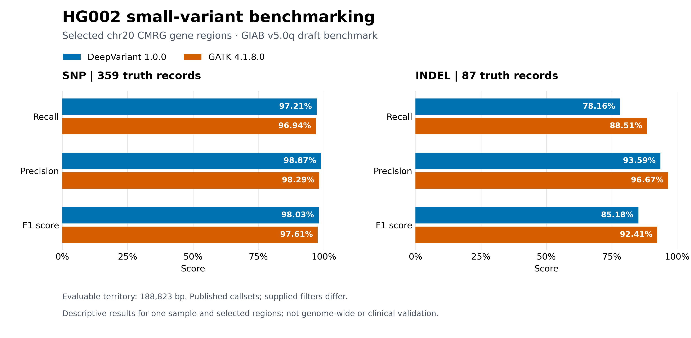

# HG002 Küçük Varyant Benchmark Projesi

**Hazır DeepVariant ve GATK çağrılarını karşılaştıran, gen ve kayıt
düzeyinde hata analizi içeren yeniden üretilebilir bir iş akışı.**

[English README](README.md)

## Araştırma sorusu

İki araç hangi küçük varyantları buluyor veya kaçırıyor?
Farklar hangi genlerde yoğunlaşıyor; INDEL uzunluğu ve tandem tekrar
bölgeleriyle nasıl bir ilişki gösteriyor?

Bu proje hazır VCF'leri değerlendirir. Ham okumadan varyant çağırma veya
klinik doğrulama çalışması değildir.

## Temel sonuçlar

Aşağıdaki sonuçlar seçilmiş değerlendirilebilir bölgelere ve kullanılan
eski sürüm çağrı dosyalarına aittir; genom geneline ait tahminler değildir.

| Tür | Çağrı seti | GIAB kaydı | Kaçırılan FN | Query FP | Recall | Precision | F1 |
|---|---|---:|---:|---:|---:|---:|---:|
| SNP | DeepVariant 1.0.0 | 359 | 10 | 4 | 97.21% | 98.87% | 98.03% |
| SNP | GATK 4.1.8.0 | 359 | 11 | 6 | 96.94% | 98.29% | 97.61% |
| INDEL | DeepVariant 1.0.0 | 87 | 19 | 5 | 78.16% | 93.59% | 85.18% |
| INDEL | GATK 4.1.8.0 | 87 | 10 | 3 | 88.51% | 96.67% | 92.41% |

Bu bölgelerde GATK'nin INDEL metrikleri daha yüksektir.
SNP sonuçları birbirine yakındır; DeepVariant biraz öndedir.

MYT1'de iki araç da 1–5 bazlık 29 INDEL kaydının 28'ini bulmuştur.
16 ve üzeri bazlık 15 kaydın DeepVariant 5'ini, GATK 9'unu bulmuştur.

Uzun kayıtların tamamı tekrarlarla örtüştüğü için uzunluk ve tekrar
yapısının etkileri birbirinden ayrılamaz.

### Genel karşılaştırma grafiği

Değerler, yayımlanan sonuç tablolarının PASS özet satırlarından alınmıştır. Karşılaştırma, farklı filtre durumlarına sahip hazır callset'leri ve seçilmiş değerlendirilebilir bölgeleri kapsar.

## Gen seçimi ve kapsam

Kaynak CMRG koordinat dosyasındaki yedi chr20 geni, gen performans
sonuçları incelenmeden seçilmiştir. Altı genin değerlendirilebilir alanı
vardır; raporlanan SNP/INDEL tablolarında beşinin gerçek varyant sayısı
sıfırdan büyüktür.

SEMG1'in değerlendirilebilir alanı vardır ama değerlendirilen gerçek
SNP/INDEL kaydı yoktur. OPRL1'in benchmark kapsamıyla örtüşmesi yoktur.

| Gen | Kaynak aralık, baz | Değerlendirilebilir alan, baz | Kapsam |
|---|---:|---:|---:|
| SEMG1 | 2,735 | 2,237 | 81.79% |
| PLTP | 13,534 | 12,996 | 96.02% |
| CHRNA4 | 35,178 | 32,032 | 91.06% |
| EEF1A2 | 11,171 | 9,676 | 86.62% |
| PTK6 | 9,375 | 8,800 | 93.87% |
| OPRL1 | 20,561 | 0 | 0.00% |
| MYT1 | 139,859 | 123,082 | 88.00% |

Toplam değerlendirilebilir alan 188.823 bazdır.
VCF çıkarımındaki 10 kb çevre bölgeleri puanlanan alanı genişletmez.

## İş akışı

Nextflow; bölgeleri oluşturma, VCF seçimi, REF kontrolü, AD'siz kopya
hazırlama, iki araç için benchmark, gen bazında ölçüm, MYT1 hata analizi
ve grafik üretimini sırayla yönetir. Sekiz işlem türünde on görev vardır.

Yedi temel girdinin kaynak kimliğine ilişkin doğrulama kayıtları vardır.
Referans için FASTA biçimi değil, normalize edilmiş DNA dizisi doğrulanmıştır.

## Çalıştırma

İngilizce README'deki komutlar kullanılır. Şu aşamada kaynak dosyalar,
FASTA indeksi ve kayıtlı konteyner imajı yerelde hazır olmalıdır.
Kayıtlı girdilerin indirilmesi ve referans hazırlığı kodlanmıştır. Yeni bir bilgisayarda ortam kurulumunun ayrıca sınanması gerekmektedir.

Gözlenen ortam: Nextflow 26.10.0, Python 3.14.7, Matplotlib 3.10.9,
Podman 5.8.4, hap.py v0.3.8-17-gf15de4a ve RTG Tools 3.8.1.

Doğrulama komutu ayrıca önceki yerel analiz sonuçlarını dayanak olarak
kullanır. Büyük çalışma dosyaları Git deposuna dahil edilmez.

## Yapılan kontroller

Hazırlanan VCF'ler, referans kontrolleri, benchmark metrikleri, kayıt
kararları, gen tabloları, MYT1 CSV'leri ve PNG pikselleri karşılaştırılmıştır.

Bölge üretimini de içeren son on görevli sürüm önbelleksiz çalıştırıldı.
Bölgeler, tablolar, varyant kararları ve PNG pikselleri önceki doğrulanmış
sonuçlarla eşleşti. Önceki dokuz görevli çalışmanın kanıtı ayrıca korunuyor.

## Sınırlamalar

Tek örnek ve seçilmiş bölgeler incelenmiştir. Araçların filtreleri eşdeğer
kalite eşikleri değildir. GIAB v5.0q taslaktır. MYT1 ayrıntılı incelemesi
sonuçları gördükten sonra seçilmiştir.

Küçük veya birbirine bağlı kayıt grupları kesin neden-sonuç yorumunu
desteklemez. Ham okuma ve hizalama kalitesi incelenmemiştir.
DeepVariant'ın tam checkpoint bilgisi henüz doğrulanmamıştır.

Sonuçların tekrar üretilebilmesi, biyolojik doğruların bağımsız olarak
kanıtlandığı anlamına gelmez.

## Dosyalar ve kalan işler

`reports/` paylaşılacak tabloları, grafikleri ve kanıtları;
`docs/` yöntem ve yorumları; `scripts/` analiz ve kontrol kodlarını içerir.

Kalan iş: yeni bir bilgisayarda temiz ortam kurulumu ve veri edinmenin
uçtan uca sınanması. Girdi hazırlama mantığı çevrimdışı testlerden,
son iş akışı da yerel önbelleksiz çalıştırma kontrolünden geçti.

## Otomatik testler

On altı hedefli test şu komutla çalıştırılır:

    python3 -m unittest discover -s tests -v

Testler için genom dosyası indirmek veya konteyner çalıştırmak gerekmez.
Bölge sınırları, birleşim hesabı, sıfır kapsam, tekrarlı gen adı,
geçersiz koordinat, mevcut çıktıları koruma, ALT sırası ve kısmen eksik
genotiplerin korunması kontrol edilir.

On altı test de yerel çalışmada geçti. Bu, bütün VCF gösterimlerini
kapsayan eksiksiz bir test paketi değildir.

Ek girdi hazırlama testleri, yanlış dosya kimliğinin reddini, güvenli kaydetmeyi, referans biçimini ve tekrar çalıştırmayı yapay dosyalarla sınar.

## Lisans ve dış kaynaklar

Projeye ait özgün kod ve belgeler [MIT lisansı](LICENSE) kapsamındadır.
Dış kaynaklı veriler, korunan kaynak belgeler ve harici yazılımlar
bu lisansın kapsamı dışındadır.
Ayrıntılar için [dış kaynak açıklamalarına](THIRD_PARTY_NOTICES.md) bakın.

## Ayrı kurulum denemesi

Aynı Fedora bilgisayarda ayrı GitHub kopyası ve yeni Python sanal ortamı
kullanıldı. Yedi temel girdi ve FASTA indeksi kayıtlı kaynaklardan yeniden
hazırlandı. 16 test geçti; on iş akışı görevi önbelleksiz tamamlandı.

Karşılaştırmanın 35 kontrolünden 34'ü geçti. Hazırlanan VCF'ler,
referans kontrolleri, benchmark metrikleri, varyant kayıtları, gen bazında
sonuçlar, bölge üretimi ve MYT1 tabloları eşleşti.
PNG piksel eşitliği sağlanmadı.

Aynı çizim kodu ve aynı tablolarla yapılan kontrollü denemede eski ortam
eski PNG'yi, yeni ortam yeni PNG'yi birebir üretti. FreeType ve bazı
bağımlılıkların sürümleri farklıydı; tek bir bileşen kesin neden olarak
belirlenmedi. İlk FAIL raporu korundu.

Nextflow, Podman ve mevcut benchmark imajı aynı bilgisayardan kullanıldı.
Bu deneme, farklı bilgisayarda kurulum testi değildir.

[Deneme kanıtı](reports/validation/installation_trial/summary.json)
